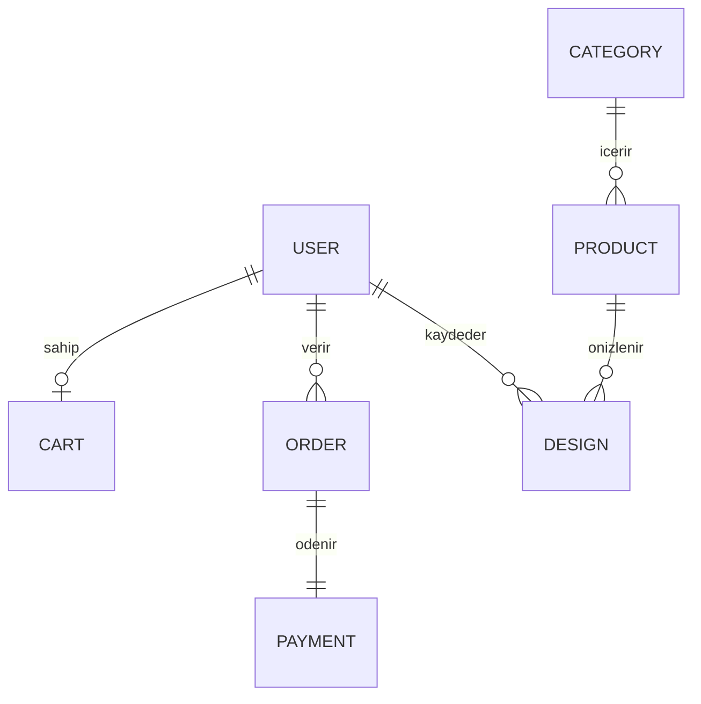

# Kod rehberi

Bu dosyada projenin nasıl çalıştığını basitçe anlatıyoruz. Sunumda veya canlı kodlamada bir yeri açıklamamız gerektiğinde buradan başlayabiliriz.

## 1. Genel yapı

Proje iki parçadan oluşuyor:

- **Sunucu (`server/`)**: Express ile yazılmış bir API. Tarayıcıdan gelen istekleri alır, MongoDB'ye yazar ve okur.
- **Arayüz (`src/`)**: React ile yazılmış sayfa. Sunucuya `fetch` ile istek atar (`src/util.js` içindeki `api()` fonksiyonu).

Geliştirme sırasında ikisi aynı porttan (3000) çalışır. `server/index.js` sunucuyu açar ve Vite'ı da içine bağlar.

## 2. Sunucu dosyaları

| Dosya | Ne yapar? |
| ----- | --------- |
| `index.js` | Veritabanına bağlanır, örnek verileri ekler, sunucuyu başlatır |
| `app.js` | Oturum ayarları, güvenlik kontrolü ve tüm rotaların bağlanması |
| `db.js` | Tablolar: kullanıcı, ürün, kategori, sepet, sipariş, ödeme, olay, yerleşim, ayar, kupon, log, bildirim |
| `rules.js` | Hata mesajları (VAL-001…VAL-020), varsayılan ayarlar, fiyat hesabı, sipariş durum sırası |
| `helpers.js` | `auth` (giriş yapmış mı?), `roles` (rolü uygun mu?), `audit` (log yaz), `trackEvent` (analitik olay), sepet hesabı |
| `seed.js` | Örnek 4 ürün ve eski rol adlarını yenilere çevirme |
| `routes/auth.js` | Kayıt, giriş, çıkış, analitik izni |
| `routes/catalog.js` | Ürün listesi, ürün detayı, 3D önizleme bilgisi |
| `routes/cart.js` | Sepete ekle, adet değiştir, sepetten çıkar |
| `routes/addresses.js` | Adres ekle, düzenle, sil |
| `routes/orders.js` | Sipariş oluştur, ödemeyi doğrula, iptal et |
| `routes/designs.js` | 3D yerleşimi kaydet, aç, sil; fotoğraf yükle |
| `routes/notifications.js` | Bildirimleri listele, okundu yap |
| `routes/admin.js` | Ürün ve kategori ekle/düzenle, sipariş durumu, rol değiştir |
| `routes/settings.js` | Site ayarları, indirim kodları, denetim kaydı |
| `routes/reports.js` | Rapor ve CSV dışa aktarma |
| `routes/visitors.js` | Sitedeki anlık ziyaretçi sayısı |
| `create-admin.js` | Terminalden ilk admin hesabını açar |

Her rota dosyası aynı kalıpta yazıldı:

```js
export default function registerCartRoutes(app) {
  app.get("/api/cart", auth, roles(...BUYERS), async (req, res) => { ... });
}
```

Burada `auth` önce kullanıcının giriş yapıp yapmadığına bakar. `roles(...)` da rolünün bu işleme izinli olup olmadığına bakar. Bir butonu arayüzde gizlemek yetmez, kontrol mutlaka sunucuda yapılmalı.

## 3. Arayüz dosyaları

| Dosya | Ne yapar? |
| ----- | --------- |
| `main.jsx` | Ana sayfa, katalog, ürün detayı, sepet, giriş/kayıt, hesabım ve siparişlerim pencereleri |
| `Studio.jsx` | "Bahçede Gör" 3D önizleme ekranı |
| `Admin.jsx` | Yönetim paneli sekmeleri: ürünler, kategoriler, siparişler, raporlar, kullanıcılar, ayarlar, denetim |
| `AddressForm.jsx` | Yeni adres formu |
| `hooks.js` | Kaydırınca beliren animasyonlar, canlı ziyaretçi sayısı |
| `util.js` | `api()`, para biçimi, rol ve sipariş durumu yazıları |
| `style.css` | Tüm stiller |

## 4. Sipariş nasıl oluşuyor?

1. Üye ürünü sepete ekler. Sepet veritabanında tutulur (`carts`). Sunucu her eklemede stoğu kontrol eder.
2. Sepet penceresinde ara toplam, indirim, kargo ve genel toplam görünür. Bu tutarları **sunucu** hesaplar (`rules.js → priceSummary`). Tarayıcıdan gelen fiyat dikkate alınmaz.
3. Üye adresi seçer, mesafeli satış sözleşmesini onaylar ve ödemeye geçer. Sipariş "Ödeme bekliyor" durumunda kaydedilir.
4. iyzico varsa kullanıcı iyzico'nun ödeme sayfasına gider. Yoksa demo ödeme hemen yapılır.
5. Sunucu ödemenin gerçekten yapıldığını iyzico'ya sorar ve tutarı karşılaştırır (`orders.js → finalizeOrder`). Ödeme sayfasından geri dönmek tek başına ödeme kanıtı sayılmaz.
6. Ödeme doğruysa stok düşer ve sipariş "Ödendi" olur. Aynı ödeme iki kez gelse bile stok yalnızca bir kez düşer.
7. Yönetici siparişi sırayla Hazırlanıyor → Kargolandı → Teslim edildi yapar. Adım atlanamaz.

## 5. 3D önizleme nasıl çalışıyor?

`src/Studio.jsx` dosyasında:

- Three.js ile bir sahne kurulur. Arka plan, yüklenen bahçe fotoğrafıdır.
- Ürünün `model3dUrl` alanı `builtin:chair` gibi bir değerse model kutulardan çizilir (`buildBuiltin`). `https://...glb` ise dosyadan yüklenir.
- Fare ile sürükleme, tekerlekle büyütme; telefonda iki parmakla büyütme ve döndürme yapılır.
- Fotoğraf yalnızca tarayıcıda tutulur. Kullanıcı "fotoğrafı da hesabıma kaydet" derse sunucuya gönderilir.
- Önizlemeyi herkes kullanabilir. Kaydetmek ve sepete eklemek için giriş gerekir.

## 6. Analitik ve raporlar

- Ziyaretçi ilk girişte "İzin ver / Reddet" bandını görür. İzin vermezse hiçbir davranış olayı kaydedilmez.
- İzin verdiyse ürün görüntüleme, sepete ekleme, ödeme başlatma gibi olaylar `events` tablosuna yazılır.
- Yönetim panelindeki Raporlar sekmesi bu olaylardan görüntüleme sayısı, sepet terk oranı ve dönüşüm oranını hesaplar (`routes/reports.js`).

## 7. Veri modeli



Siparişte ürün adı ve fiyatı o anki haliyle kopyalanır. Sonradan fiyat değişse bile eski sipariş değişmez.

## 8. Sık yapılacak değişiklikler

- **Yeni kategori:** Kod gerekmez. Yönetim paneli → Kategoriler.
- **Kargo ücreti veya ücretsiz kargo sınırı:** Kod gerekmez. Yönetim paneli → Ayarlar (sadece admin).
- **Yeni ürün alanı (ör. malzeme):** `db.js` şeması → `routes/admin.js` içindeki `PRODUCT_FIELDS` → `Admin.jsx` formu → ürün kartı.
- **Yeni hata mesajı:** `rules.js` içindeki `MSG`.
- **3D modelin şekli:** `Studio.jsx` içindeki `buildBuiltin()`.

Bir değişikliği yaparken şunu açıklayabilmeliyiz: Neden yaptık? Hangi dosyada? Nasıl test ettik?
