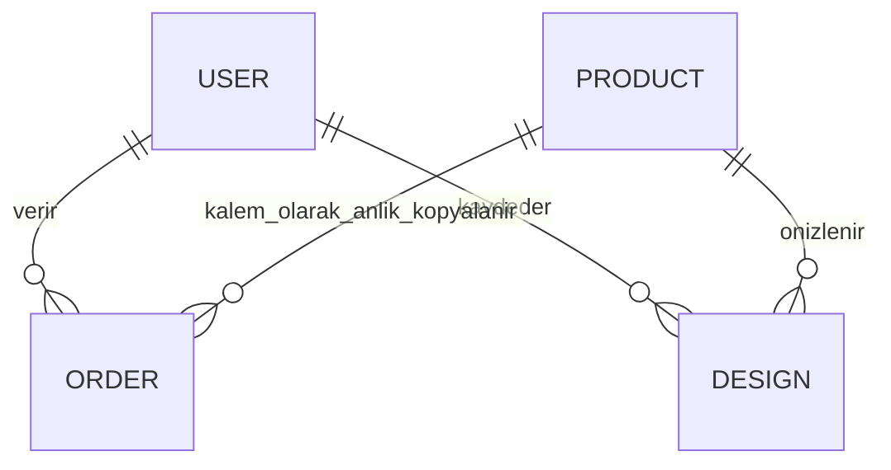

# Kodu anlama ve sunum rehberi

## Katmanlar

- `server/db.js`: Mongoose şemaları (SRS 2: users, categories, products, carts, orders, payments, events, designs, settings, coupons, auditlogs, notifications) ve MongoDB bağlantısı.
- `server/rules.js`: VAL mesajları, parametre varsayılanları/doğrulaması, BR-003 tutar hesabı, BR-009 durum geçişleri, rapor saat dilimi.
- `server/app.js`: HTTP uçları, oturum ve rol kontrolü, sepet/ödeme/stok mantığı, analitik, raporlar, denetim kaydı, bildirimler ve şema geçişi (`migrate`).
- `server/index.js`: MongoDB bağlantısı, örnek ürünler, geliştirmede Vite ve üretimde statik dosyalar.
- `server/create-admin.js`: yalnızca yerel yetkili terminalden ilk admin.
- `src/main.jsx`: React katalog, üyelik, sepet, sipariş, adres, bildirim ve analitik izin ekranları.
- `src/Admin.jsx`: yönetim paneli (ürün, kategori, sipariş, rapor, kullanıcı, ayar, denetim sekmeleri).
- `src/Studio.jsx`: Three.js sahnesi, temsili/GLB model, sürükleme, dokunmatik ölçek/dönüş, ürün değiştirme ve yerleşim kaydı. Fotoğraf `blob:` adresiyle tarayıcıda tutulur; yalnızca kullanıcı isterse sunucuya gider.
- `src/util.js`: ortak API çağrısı, para biçimi, rol/durum etiketleri.
- `tests/api.test.js`: gerçek MongoDB ile API entegrasyonları.
- `tests/browser.spec.js`: gerçek Chromium ile görünüm ve 3D etkileşimi.

## Sipariş nasıl çalışır?

1. Sepet sunucuda (`carts`) tutulur; tarayıcı yalnızca ürün kimliği ve adedi yollar, fiyatı belirleyemez.
2. API oturumu, rolü (Üye/Admin), adresi ve mesafeli satış onayını (VAL-005/006) kontrol eder.
3. Ürün durumunu ve stoğunu kontrol eder (VAL-003/004), fiyatları MongoDB'den okur; `priceSummary` ile ara toplam, indirim, kargo ve genel toplamı hesaplar.
4. Sipariş `pending`, ödeme kaydı `payments` içinde `pending` olarak saklanır; `checkout_start` olayı (izin varsa) yazılır.
5. iyzico varsa checkout form başlatılır. Ödeme dönüşü tek başına güvenilmez; callback ve “Ödeme durumunu doğrula” sağlayıcının `retrieve` servisini sorgular ve tutarı karşılaştırır.
6. `finalizeOrder` siparişi `pending → processing` koşullu güncellemesiyle tek seferde sahiplenir (tekrarlı callback ikinci kez işlemez), `providerRef` benzersiz kaydedilir ve stok `stock >= quantity` koşullu atomik güncellemeyle düşer. Stok yetmezse önceki düşümler geri alınır.

Rolü frontendde bir düğmeyi gizlemek güvenlik sağlamaz. `auth` kullanıcının güncel kaydını veritabanından okur, `roles()` rolü kontrol eder ve reddedilen erişimi `unauthorized_access` olarak denetim kaydına yazar. Üyelik isteğindeki `role` alanı kullanılmaz. Kullanıcı sipariş sorgusu kendi oturum kimliğiyle sınırlandırılır.

## Veri modeli

Sipariş kalemleri ürünün sipariş anındaki adını ve fiyatını içerir; sonradan fiyat düzenlemek geçmiş siparişi değiştirmez.

## Canlı kodlama hazırlığı

- Yeni kategori: Yönetim paneli → Kategoriler; kod değişikliği gerekmez.
- Yeni ürün alanı: şema → API doğrulama/izinli alan listesi → admin form → ürün kartı → anlamlı test.
- Fiyat filtresi: React ürün dizisini filtrele; API üzerinden gelen fiyatları kullan.
- Rol ekleme: `ROLES` (db.js), `roles(...)` çağrıları, `ROLE_LABELS` (util.js); yetkisiz istek testini güncelle.
- Yeni parametre: `DEFAULT_SETTINGS` ve `RULES` (rules.js), Ayarlar formundaki `FIELDS` (Admin.jsx), gerekiyorsa `/api/settings/public`.
- 3D modeli değiştir: üründe `model3dUrl` alanına `builtin:chair|sofa|table|lounger` veya HTTPS `.glb` adresi girilir; temsili geometri `buildBuiltin()` içindedir.

Bir değişikliği neden yaptığını, hangi katmanda kontrol edildiğini ve nasıl test edildiğini kendi cümlelerinle açıklayabilmelisin. README'yi ezberlemek kod hakimiyeti yerine geçmez.
